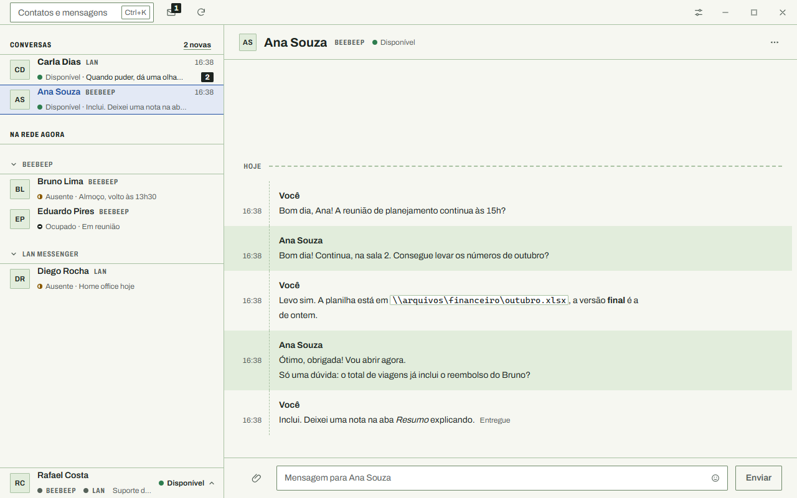
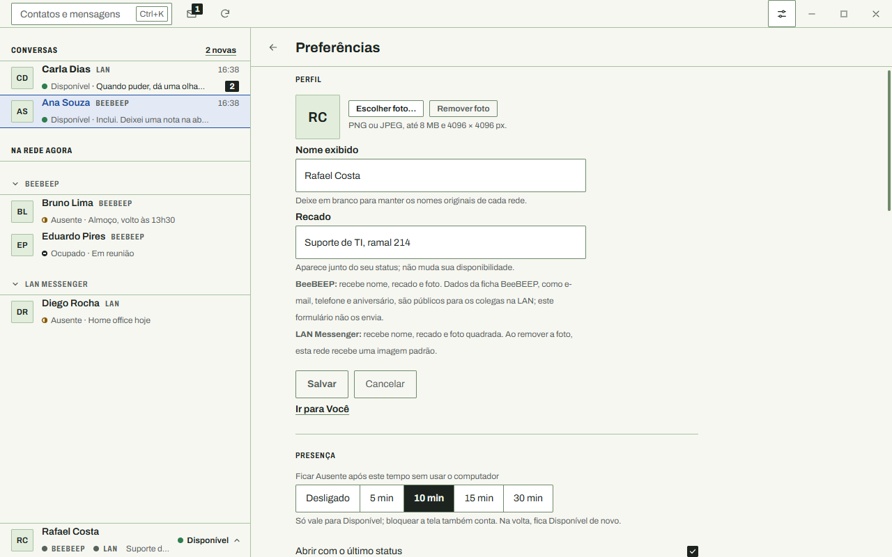

At work we use two chat apps for the office network:
[BeeBEEP](https://www.beebeep.net/) and
[LAN Messenger](https://github.com/lanmessenger/lanmessenger). Some people
are on one, some are on the other, and the two can't talk to each other.

So I had both open all day. Two icons in the corner of the screen, two contact
lists, two places a message could be hiding. Before writing to someone I had
to remember which app they used. Everybody worked like that, and nobody
questioned it. That's just how it was.

It bothered me every day, so I started looking for a way to reach everyone from
one app.

## Looking inside

Both apps are open source, so the first thing I did was download their code
and start reading. I wanted to know one thing: when one of these apps sends
"hi" to another computer, what exactly goes over the network?

That code is written in C++, a language I'm not comfortable with. Reading it
was slow. I took notes on everything, and little by little I had a
description of each app's "language".

The next four sections are what those notes say, in plain words. I asked the
same questions of both apps. How do they find each other? How do they say
hello and keep strangers from reading along? What does one message look like?
And how do files travel?

## How they find each other

Neither app has a server. There is no central list of who is online. Each
copy has to find the others on its own, and both do it the same way. They
call out to the whole network and wait for someone to answer.

Computers on a network have two common ways to send data, and both apps use
both. UDP sends single, standalone messages. There is no connection, and no
promise that a message arrives. TCP opens a connection between two computers,
a two-way line where the bytes arrive complete and in order. Both apps use
UDP to call out, and TCP for everything after that.

A call can go out as a broadcast, which every computer on the local network
receives. Or it can go out as a multicast, which is sent to a group address
and only reaches the computers that joined that group.

LAN Messenger calls out on UDP port 50000, to the multicast group
239.255.100.100 and as a broadcast. The call is a short piece of XML, a text
format where each value sits between labels in angle brackets. It says
"announce" and carries the sender's user ID. When LAN Messenger starts, it
sends "depart" and then "announce". A copy that hears an announce from
someone it doesn't know yet opens a TCP connection to that computer, also on
port 50000.

BeeBEEP calls out on UDP port 36475, to the multicast group 224.0.64.75 and,
out of the box, as a broadcast too. Its call is even shorter. It
doesn't carry a name, only the word "BEE-BEEP" and the TCP port where this
copy is listening, 6475 by default. A copy that hears it connects to that
port.

Neither call is locked. Anyone on the network can read them, but there's not
much to read.

![Two columns, LAN Messenger and BeeBEEP, four steps each. LAN Messenger: call out over UDP port 50000 to multicast 239.255.100.100 and broadcast, with an XML announce and the user ID; whoever heard it connects over TCP port 50000 and sends MSG with its user ID; the two agree on a secret key using a public key; then they trade name, status and note. BeeBEEP: call out over UDP port 36475 to multicast 224.0.64.75 and broadcast, with BEE-BEEP and the TCP port but no name; whoever heard it connects to that port, 6475; both send a BEE-CIAO hello with name, status, version and a public number, locked with a fixed key; both work out the same key from their own secret number and the other's public number.](../../assets/beebeep/find-and-connect.svg)

## Saying hello and locking the line

Once the TCP line is open, the two computers introduce themselves and agree
on a secret key. Every chat message after that is locked with the key, so the
other computers on the network can't read it.

LAN Messenger uses a lock in two steps. When it starts, each copy makes a
pair of keys: a public key it hands to anyone, and a private key it keeps.
Whatever is locked with the public key can only be unlocked with the matching
private key. Then, on each new line:

1. The computer that called sends "MSG" followed by its user ID.
2. The other computer answers with its public key.
3. The caller makes up a random secret key, locks it with that public key,
   and sends it back.
4. The other computer unlocks it with its private key.

Now both sides hold the same secret key, and it never crossed the network in
the clear. They lock every message with it, using AES, a standard method for
locking data with a secret key. Only then do they trade names, status, and
the short note each person can set.

BeeBEEP introduces itself first. The computer that called sends a hello
message, "BEE-CIAO", and the other side answers with its own. Each hello
carries fifteen fields, among them the listening port, the name, the status,
the app version, the computer's name, and a public number.

The key comes from those public numbers. Each side also has a secret number
that it never sends. It combines its own secret number with the other side's
public number, and the math gives both sides the same result, even though
the result itself never crossed the network. That result becomes the key for
every message after the hello. BeeBEEP also uses AES, and it locks in fixed
blocks of 16 bytes, so it pads each message with spaces until it fills the
last block. A byte is the smallest piece of data a computer sends, enough for
one plain letter like "h".

The hello can't use that key, because the hello is what carries the public
numbers. So BeeBEEP locks the hello with a key made from a network password
instead, or at least it means to.

## What one message looks like

Say I type "hi" and press Enter. Each app wraps it in a few layers before it
goes on the line.

LAN Messenger writes it as XML:

```xml
<lmcmessage>
  <head>
    <from>user-a</from>
    <to>user-b</to>
    <messageid>1002</messageid>
    <type>message</type>
  </head>
  <body>
    <font>Arial,10,-1,5,50,0,0,0,0,0</font>
    <color>#202020</color>
    <message>hi</message>
  </body>
</lmcmessage>
```

The head says who it's from, who it's for, the message number and the type.
The body has the font, the color and the text. The app locks all of that,
puts the six letters "MESSAG" in front so the other side knows what kind of
data it is, and puts the length in front of everything as a 4-byte number.
That number is the size label. It tells the receiver how many bytes to read
before the message ends.

When it arrives, the receiver unlocks it, shows it, and sends back an
"acknowledge" with the same message number. If the acknowledge doesn't come
in time, the sender sends the message again.

BeeBEEP doesn't use XML. It writes the message as one line of seven fields,
separated by an invisible character:

1. the kind of message, "BEE-CHAT";
2. a message number;
3. the length of the text;
4. a number for the flags, where 1 means a private chat;
5. a data field for extras like the text color, empty here;
6. the time;
7. the text itself, "hi".

Every kind of BeeBEEP message starts with a word like that. The hello is
"BEE-CIAO", the call on the network is "BEE-BEEP", and a file offer is
"BEE-FILE". BeeBEEP pads the line with spaces, locks it block by block, and
puts the size label in front.

When it arrives, the receiver sends back "BEE-RECV" with the message's
number, so the sender knows it was delivered. When the person opens the chat,
their app sends "BEE-READ", and the message shows as read.


## How files travel

Neither app sends a file through the chat line. The chat line carries the
offer and the answer, and the file itself goes over a second TCP connection.
The details differ, down to who calls whom.

In LAN Messenger, the offer is an XML "file" message saying "request", with
the file's ID, name and size. The other side answers "accept". Then the
sender opens a new connection to the receiver, on the same port 50000 as the
chat, and starts it with "FILE", the file's ID and its own user ID. The
receiver answers "START", and the sender streams the file in pieces of up to
65,535 bytes. Those pieces aren't locked. Only the chat line is.

In BeeBEEP, the offer is a "BEE-FILE" message with the file's name, its size,
an ID, a password for this one file, the date the file was last changed, its
type, and the port where the sender waits for file connections, 6476 by
default. If the other person accepts, their app connects to that port. The
new connection starts with the same hello and the same lock as the chat.
Then the receiver asks for the file by its ID and password, and the sender
sends it in pieces. The receiver confirms each piece, and the sender waits
for that confirmation before it sends the next one.

![Two columns comparing file transfers. LAN Messenger: an XML file request with ID, name and size on the chat line; the other side answers accept; the sender connects to the receiver on port 50000 and starts with FILE, the file ID and its user ID; the receiver answers START and the raw bytes follow in pieces of up to 65,535 bytes, not locked. BeeBEEP: a BEE-FILE offer with name, size, ID, password, port 6476, date last changed and type; the receiver connects to the sender on that port; same hello and lock as the chat, then the receiver asks for the file by ID and password; the file comes in pieces, each one confirmed before the next.](../../assets/beebeep/file-transfer.svg)

## Only messages, never code

Writing all of that down took a long time. And honestly, my interest was low
at that point. Most of the people I needed to talk to sat near me, so
whenever the two apps got in the way, I just got up and talked to them in
person. That short-circuited the whole problem, and the project went quiet
for a month at a time.

Every step in the last few sections is a message on the network, and the
other computer never sees the code that produced it. If my program sends
exactly the same bytes, in the same order, at the right moments, the original
apps treat it as one of their own. So my app could join both networks as a
member, and I didn't need C++ to build it.

I did try. I spent some time learning C++, and I tried QML, the language Qt
uses for its interfaces. But JavaScript was already familiar to me, and it's
what the company already uses. On top of that, everything about these apps was
confusing at the start, and in JavaScript I could map out the big ideas first
without getting lost in the details.

## Learning the language before talking

I started with LAN Messenger, and I made myself one rule: no talking to the
network until I could write and read its messages perfectly on my own
computer.

So the first piece I built was a translator. It takes a message like "Leonardo
says hi" and turns it into exactly the bytes LAN Messenger expects to receive,
and it does the reverse for incoming messages. Programmers call this a codec,
short for coder/decoder. I tested it against real messages until it got every
one of them right.

I had AI tools around while I did this, but I used them for small pieces, and
I checked every line they gave me against the original apps. Later I also set
up workflows where AI agents wrote the code for a piece of work I had already
planned. I still read everything that came back and decided every next step
myself. I didn't trust them to drive. Code like this has to match another
program byte for byte, and I didn't want something guessing at it.

Only when the translator was right did I connect it to the real network.
Eventually I had a small desktop window where LAN Messenger contacts showed
up, and I sent a message to another computer on the network running the
original app. It arrived.

After that first message, every piece I got working made the two apps on my
screen more annoying, because now I could see how close I was to getting rid
of one of them. The closer it got to something I could use every day, the
less patience I had for the old way, and that impatience is what brought me
back to the project after each pause.

## The day it didn't work

Then I did the same for BeeBEEP. I built it, and to test it I ran two copies of
my own program. They found each other, said hello and chatted. I thought I was
done.

So I tried it with a real BeeBEEP on the office network, and got nothing.
The real app could see mine and tried to say hello, but the conversation died
on the spot.

The problem was that my two copies agreed with each other because they had
the same mistakes. Testing against myself proved nothing.

So I recorded what the real BeeBEEP was sending and compared it against its
code, line by line. Both problems were in the hello.

The first was the size label. Every message after the hello has a 4-byte size
label. But when the hello goes out, neither side knows the other's version
yet, so BeeBEEP writes it with an older, 2-byte label. My program expected 4
bytes on everything.

The second was the lock on the hello. It's supposed to use a key made from
the network password. But one comparison in that part of the code is
backwards, so every byte of the key stays zero, whatever the password is. The
hello is locked with a key of nothing but zeros. Right above that line sits a
comment that literally says "What the hell...".

I copied both quirks exactly. The next time I ran it, my program showed up in
the real BeeBEEP's contact list, and its people showed up in mine.

That day also changed how I tested. From then on, my tests checked my program
against recordings of the real apps and against their code, never just
against another copy of itself.

## Putting it together

With both working, I put them into one desktop app. It's built in four
layers, and each layer only talks to the ones next to it.

At the bottom are the two translators, one per protocol. They turn a message
into exact bytes and back, and nothing else. They never touch the network.

Above each translator is an engine, one per network. The engine does
everything from the sections above. It calls out, opens connections, says
hello, locks and unlocks, sends receipts, resends what wasn't confirmed, and
moves files. It uses its translator for every message.

Above the engines is a common layer that makes both networks look the same.
For each network, an adapter turns the engine's events into the same few
things: a contact, a message, a file transfer. Then one piece collects both
networks, gives every contact an ID that starts with the name of its network,
and sends each message to the right engine. Two people with the same name on
different networks never get mixed up. If one network fails to start, the
other keeps working.

At the top is the window. It's a desktop app built with Electron, which lets
you build a desktop app with the same tools as a web page. The window only
talks to the common layer. It doesn't know what XML is, or what "BEE-CHAT"
means.


The window is where the original problem finally went away:

- One list. At the top are the people I've talked to, from both networks.
  Below them is everyone else who is online, grouped by network, with BeeBEEP
  first because it's the better of the two.
- One search box that finds people on both networks and also searches old
  messages.
- My app shows up in both networks at once, so nobody else has to install
  anything or change anything. If you still use the original BeeBEEP or LAN
  Messenger, you can reach me and I can reach you.
- If one of the networks has a problem, the other keeps working.

Eventually I chatted with both original apps on another computer, in both
directions, from the same window. The two icons in the corner became one.

## Past the finish line

That was the finish line I had set for myself: one window, both networks,
talking to the original apps in both directions.

Up to there, the understanding was mine. I read the C++ myself, wrote down
each protocol myself, and found the quirks by putting recordings next to the
code. AI had helped with pieces along the way, and I had checked every line
of it.

Once I was past the line, I decided to try it the other way and let the AI do
the work while I directed it. I didn't expect much. I expected to spend my
time fixing what it got wrong.

Instead, it had to prove every change. Each one came with a test that failed
before the change and passed after it. The tests checked my app against
recordings and the code of the real BeeBEEP and LAN Messenger, not against
itself. That was the lesson from the day BeeBEEP didn't work, and now it
applied to the AI too.

Before the bigger changes went in, a second AI, a different model, reviewed
the first one's work and tried to break it. More than once it found something
real. It found that if I changed my name in the app, file transfers to
BeeBEEP would still introduce me by the old one. Each file connection starts
with its own hello, and that hello still carried the old name. I would never
have caught that by hand.

And I kept using it every day on the office network. That was the last check,
and the one I trusted most.

It was also fast. In the last stretch, more changed in a few weeks than in all
the months before. One day I had eight agents working at
the same time, each on a different part of the window, while I reviewed what
came back. I wrote more about that way of working in
[I stopped typing and started directing](/blog/i-stopped-typing/).

It took the project far past where I had planned to stop. Most of what
follows came after that decision.

## A third me

Once I used it for real, my colleagues saw a new contact with my name. To
them there was the me on BeeBEEP, the me on LAN Messenger, and now a third
one.

Their apps had no way to know it was the same person. LAN Messenger
recognises people by the user ID that goes in every announce and every
message, built from the computer's network card and the Windows login.
BeeBEEP recognises them by name and by a random code it saves the first time
it runs and sends in every hello. My app had introduced itself with its own.

So now my app reads the original apps' settings on my computer, without
changing them, and introduces itself with the same name and the same ID. To
my colleagues I'm one person again, whichever app I happen to have open.

## Bugs you only find by using it

After that I used it every day, at my desk, with the people around me. When
something looked wrong, I took a screenshot, pulled the app's log, and worked
out what had happened. Two of those stuck with me.

Text worked fine, but whenever I sent a file to someone on BeeBEEP, their app
hung up on mine in under a tenth of a second, and they disappeared from my
list. The cause was one empty field. The file offer carries the date the file
was last changed, and my app left it blank. The original BeeBEEP doesn't
complain about a message it doesn't like. It just closes the connection.
Filling in the date fixed it.

Another time my app said LAN Messenger was unavailable. The original LAN
Messenger was still installed and running on my computer, holding port
50000, which both programs need, and only one of them can have it. Now my app
waits and tries again every few seconds, and connects on its own as soon as
the original closes.

## What it is now

It's the app I use all day at work, instead of the two it replaced.



Besides chatting, it can:

- send and receive files and whole folders, with people on either network;
- keep the history on my computer and search it;
- show formatting, code, link previews and images;
- show when a message was read and when someone is typing;
- notify me, sit in the tray, and start with Windows;
- set me as away when I leave the computer;
- send my name, a short status note and a photo to both networks, and update
  them live when I change them.



It took about four and a half months, in three bursts with a quiet month
between each. By the end there were 561 commits, about a hundred pull
requests, and around 1,500 automated tests that run before any change goes
in.

The code is on GitHub, under the same license as the two original apps:
[github.com/Lmedeiros-leiman/LanMessaging-BeeBeepLanMessenger](https://github.com/Lmedeiros-leiman/LanMessaging-BeeBeepLanMessenger)

## Looking back

I came out of this knowing far more about how computers talk to each other
than I did when I started, and I learned all of it by needing it. I know how
a computer finds others with no server, how two strangers agree on a key in
public, and why a message needs a size label, all because a chat app at work
annoyed me.

This project is also where I learned two things about AI. It can move much
faster than I can, and I can trust it, as long as it has to prove every change
and someone keeps checking. I didn't believe either of those when I started.

I also came close to never starting. "It's just how it is" felt true for a long
time, and it wasn't. Both apps were open source, and their messages could be
recorded and read.

So if something bugs you every day, look inside it. You might be able to fix
it too.
